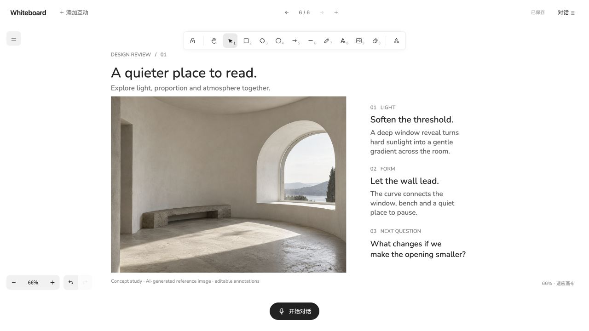
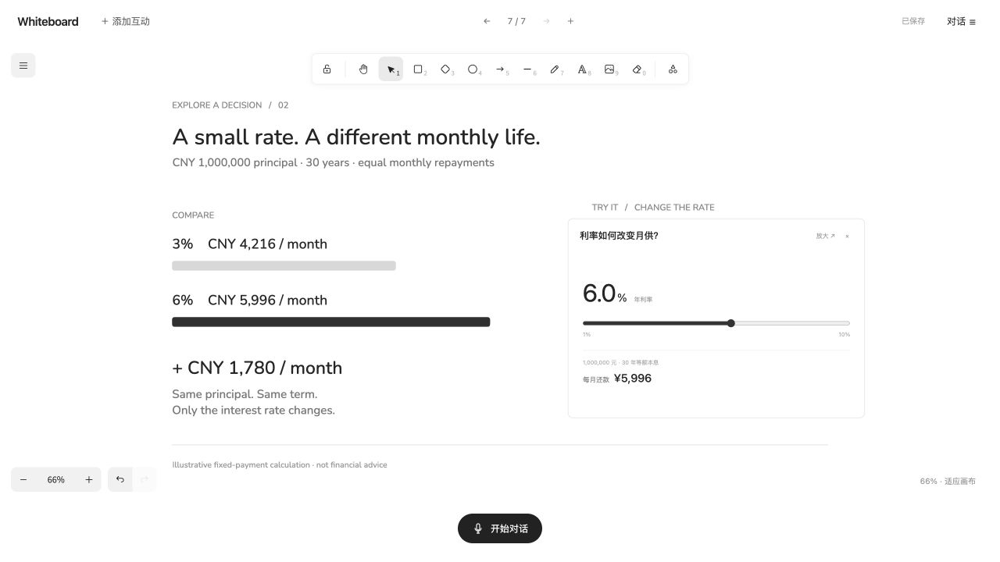
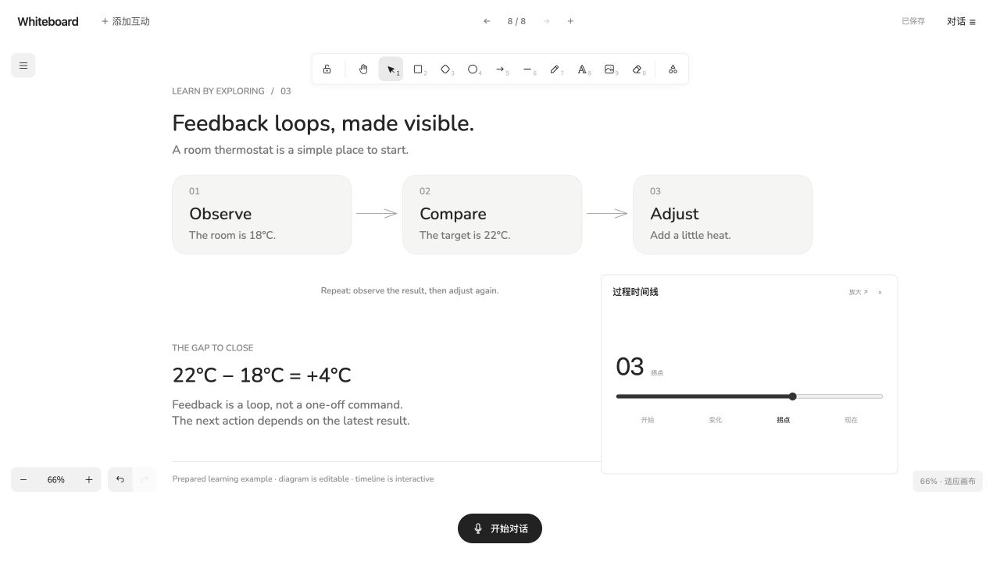
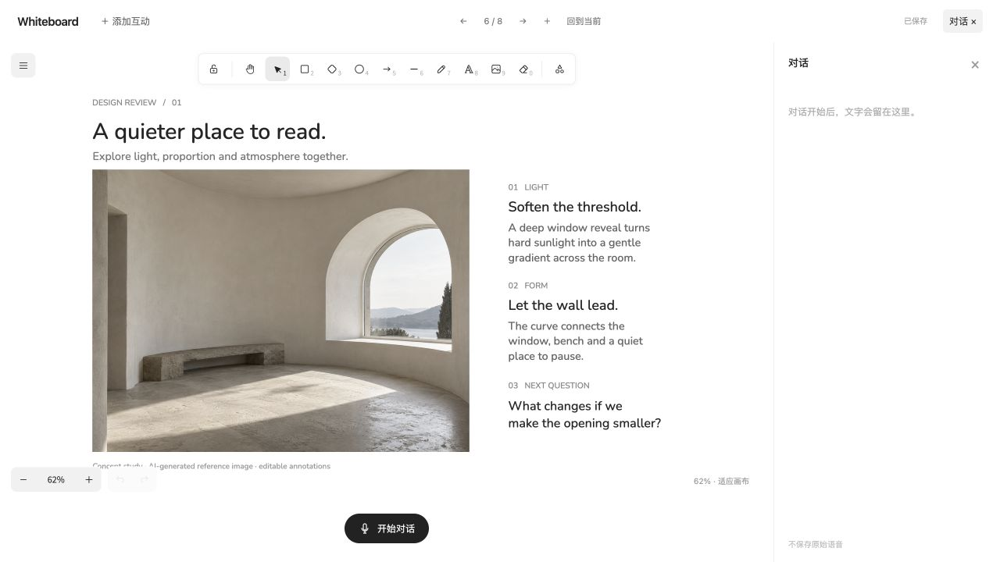
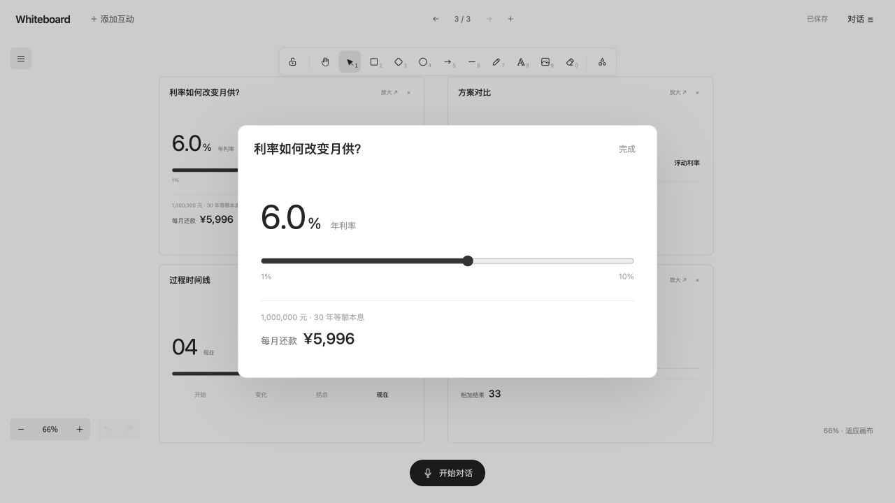
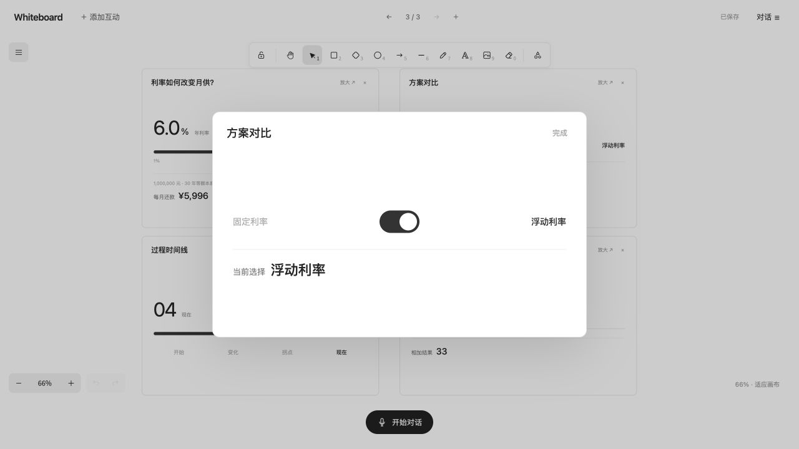
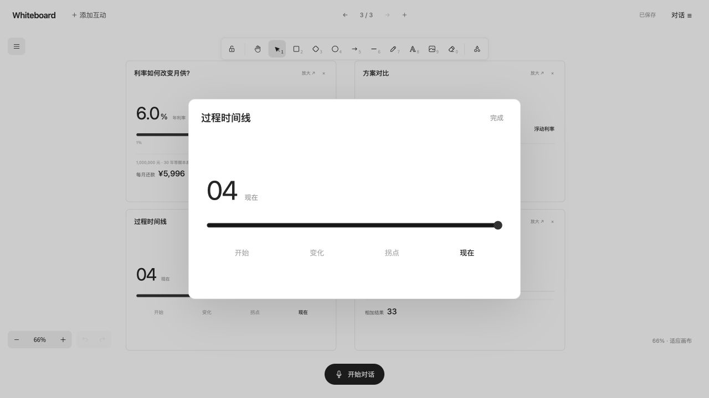
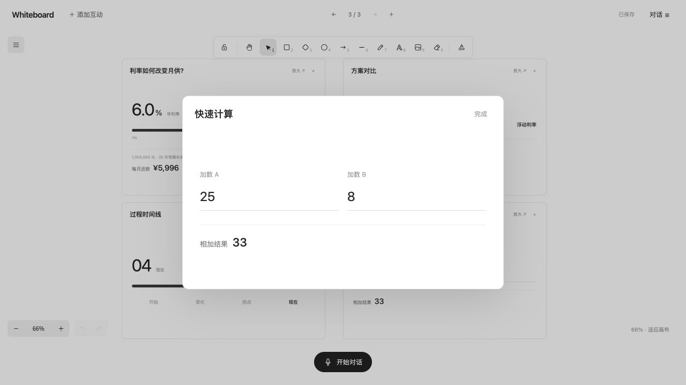

<p align="center">
  
</p>

<h1 align="center">AI Whiteboard</h1>

<p align="center">Talk, draw, and explore with AI.</p>
<p align="center">English · <a href="README.zh-CN.md">中文</a></p>

A locally running AI whiteboard prototype. Talk to Qwen in real time as it puts explanations on the board. Edit text, move objects, or change a parameter, and the AI receives the resulting board state.



## What it does

- **Talk and draw**: Qwen realtime voice, transcription, interruption, and constrained board tool calls.
- **Edit together**: text, shapes, arrows, freehand drawing, and images, with movement, resizing, and undo.
- **Interact, not just watch**: four controlled templates—a mortgage-rate slider, comparison switch, timeline, and addition calculator—with focus mode and local persistence.
- **Let AI add images**: request a reference image by voice; the AI can place a validated search result on the board with its source link and host.
- **Send precise feedback**: committed values, text, and positions enter the AI context; pointer movements are not streamed frame by frame.
- **Keep boards and transcripts**: browse and edit history while the AI works on the current LIVE board by default. Boards, final transcripts, and interactive state are saved in your browser.

## Three ways to think together

### Explore a decision

What does a change from 3% to 6% actually mean? Put the comparison beside a real, draggable interest-rate slider. Same principal, same term, a different monthly payment.



### Make a concept visible

Use a room thermostat to explain a feedback loop: observe, compare, adjust, and repeat. Combine an editable diagram with a timeline widget that can send its selected stage to the AI.



### Discuss a design

The opening image shows a reading-room study: a visual reference, a few observations about light and form, and a question to explore next. Return to an earlier board without losing the conversation workspace.



These are prepared example boards captured in the running app, not generated UI mockups or evidence of autonomous AI completion. The room reference was generated with imagegen and inserted manually; text and diagrams are editable annotations. Sliders and the timeline are real controls, but the surrounding diagrams and comparison bars do not automatically change with them. No conversation transcript was fabricated. See [asset provenance](docs/GITHUB.md).

## A closer look at the controls

Each widget opens in a focused view without losing its state.

| Parameter slider | Comparison switch |
| --- | --- |
|  |  |
| Change a rate and see the calculation update. | Switch between two named alternatives. |

| Timeline | Calculator |
| --- | --- |
|  |  |
| Move between stages of a process. | Edit the inputs and inspect the result. |

These are real application screenshots with sample data, not evidence of live voice reliability. A fresh installation starts with an empty board; create the examples from “添加互动” (Add interaction). The current UI and system prompt are primarily in Chinese.

## Quick start

Install Node.js 22 and pnpm. Download or clone this repository, then open a terminal in its directory.

### Try the whiteboard without an API key

```bash
pnpm install
pnpm dev:web
```

Open [http://127.0.0.1:5173](http://127.0.0.1:5173). Editing and interactive widgets work in this mode. Voice and image search do not; no model calls are made.

### Enable AI voice and image search

1. Prepare an Alibaba Cloud Model Studio API key and workspace ID in the Beijing region, with access to the realtime voice and image-search models.
2. Copy [.env.example](.env.example) to `.env` in the project root and enter the key and workspace ID. Do not overwrite an existing `.env`.
3. If the frontend-only server is running, stop it with `Ctrl+C`, then run:

```bash
pnpm dev
```

Open the same address, click “开始对话” (Start conversation), and allow microphone access. Headphones are recommended. Click “结束对话” (End conversation) to disconnect voice; press `Ctrl+C` in the terminal to stop the development servers.

For environment variables, troubleshooting, and data handling, see the bilingual [configuration guide](docs/CONFIGURATION.md).

### Start and stop on macOS

After installing dependencies and configuring `.env`:

- Double-click `启动 AI Blackboard.command` to start the services and open the page.
- Double-click `关闭 AI Blackboard.command` to stop the services started by that launcher.
- Closing the browser alone does not stop the local services. The launcher filenames retain the earlier project name; the product now uses a whiteboard.
- On Windows, use the terminal commands above, not the `.command` files.

## Try these interactions

After starting voice, try:

- “Explain compound interest in three steps and put the key points on the board.”
- “Add an interest-rate slider.” Set it to 6%, then ask: “What is the value now? How does the monthly payment change?”
- “Find a reference image of a bicycle and put it on the right.”
- Add text or move an element yourself, then ask: “Read what I just wrote. Where is it now?”
- “Start a new board.” Return to a previous board to review or edit it.

Tool selection and search results depend on the model and network. The AI can read structured text, positions, and widget values; **recognition of freehand marks and image contents is not implemented**. Ordinary edits usually update context without triggering an unsolicited response.

## Current limits

This is a local prototype, not the complete, publicly deployable V1:

- No accounts, invitations, cloud sync, cross-device recovery, or reliable multi-tab editing lease. Edit in one tab at a time.
- Data lives in IndexedDB for the current browser and origin. Clearing site data deletes it; `localhost` and `127.0.0.1` use separate storage.
- No in-app spending cap. Voice and image search incur Model Studio charges. Set provider-side alerts and end conversations when finished.
- Search images remain external URLs, not copies in your own storage. Links may fail or expire; attribution does not grant image rights.
- AI cannot rewrite, move, or delete user-owned elements. The one-time approval workflow is not implemented.
- Cloud deployment, automatic reconnection, and complete Windows/macOS cross-browser acceptance are unfinished. The backend has no authentication; do not expose it publicly or through a tunnel.

The application does not persist raw audio. When voice is enabled, audio, board context, and transcription are sent to the model provider. See [SECURITY.md](SECURITY.md).

## Development

React + TypeScript + Vite · Excalidraw 0.18.1 · Zustand + Zod · IndexedDB · Fastify + WebSocket · Alibaba Cloud Qwen

```bash
pnpm test     # Logic tests; no paid model calls
pnpm build    # Type checking and frontend build
```

`pnpm start` runs only the backend; it is not a complete production deployment command.

- `src/`: UI, the single BoardStore, interactive widgets, and browser audio.
- `server/`: Qwen relay, image search, and tool validation.
- `scripts/`: local start/stop helpers.
- `docs/`: bilingual configuration, GitHub copy, and screenshots.

## License and contributions

**Commercial works are allowed; commercialization of the software is not.** Under the [AI Whiteboard Source License 1.0](LICENSE), you may create and sell designs, client presentations, videos, and other outputs. Without separate written permission, you may not sell the source or modified versions, provide commercial hosting or SaaS, or incorporate the software into commercial products or services.

This is a source-available license, not MIT or an OSI-defined open-source license. The license includes English and Chinese terms; English governs. Rights to third-party material must be obtained separately.

See [NOTICE.md](NOTICE.md) for a Chinese summary and third-party boundaries. See [CONTRIBUTING.md](CONTRIBUTING.md) for issues and contributions. Do not disclose security vulnerabilities in a public issue.
